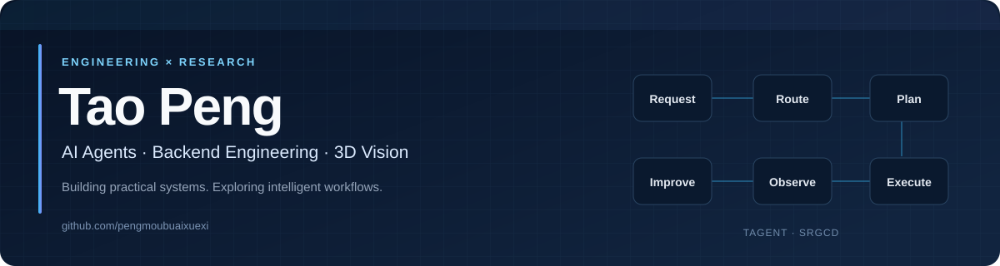
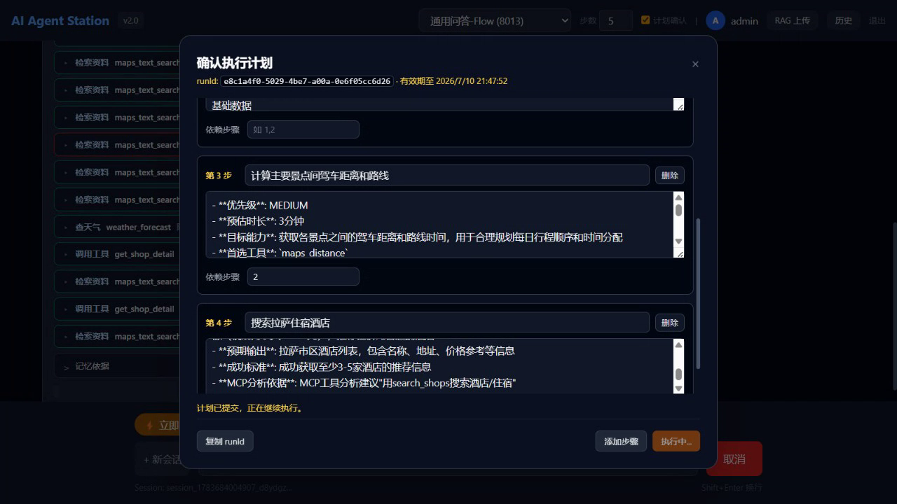
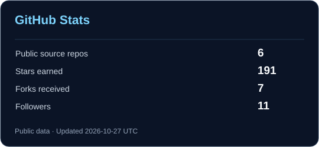
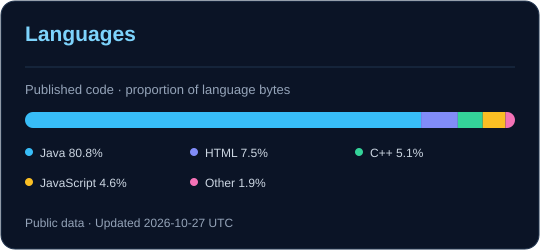

  

  

  <strong>Java Backend &amp; AI Agent Developer</strong> 
  Building TAgent · Researching 3D point cloud change detection

  <a href="https://tagentapp.cn">Live Demo</a> ·
  <a href="https://github.com/pengmoubuaixuexi/TAgent">TAgent</a> ·
  <a href="https://github.com/pengmoubuaixuexi/SRGCD">SRGCD</a> ·
  <a href="mailto:3269417457@qq.com">Email</a>

  

## Featured Work

<table>
  <tr>
    <td width="50%" valign="top">
      <h3><a href="https://github.com/pengmoubuaixuexi/TAgent">TAgent</a></h3>
      
An end-to-end AI agent engineering project built with Java, Spring Boot and Spring AI.

      
      
Frame from the project's published Flow demo (earlier UI version).

      
Fixed / Auto / Flow · Agentic RAG · MCP tools · memory · sandbox execution · persistent run traces

      
<a href="https://tagentapp.cn">Live Demo</a> · <a href="https://github.com/pengmoubuaixuexi/TAgent">Source Code</a> · <a href="https://github.com/pengmoubuaixuexi/TAgent/tree/main/docs/demo-videos">Demos</a>

    </td>
    <td width="50%" valign="top">
      <h3><a href="https://github.com/pengmoubuaixuexi/SRGCD">SRGCD</a> CVPR 2026</h3>
      
Stability-Driven Region Growth Framework for 3D Change Detection.

      
      
Original framework figure from the SRGCD repository.

      
Reliable unchanged seeds guide progressive region growth for 3D point cloud change detection.

      
<strong>Code release pending:</strong> we are developing a journal extension with further improvements and experiments. Release timing will be announced in the repository.

      
<a href="https://openaccess.thecvf.com/content/CVPR2026/html/Wu_SRGCD_Stability-Driven_Region_Growth_Framework_for_3D_Change_Detection_CVPR_2026_paper.html">Paper</a> · <a href="https://github.com/pengmoubuaixuexi/SRGCD">Project &amp; Release Updates</a>

    </td>
  </tr>
</table>

## GitHub Activity

  
  

  Real public GitHub data · updated daily · forks and this profile repository excluded. 
  Language shares describe published code bytes, not proficiency or private research code.

  <strong>Engineering with TAgent. Research with SRGCD.</strong> 
  <a href="https://tagentapp.cn">tagentapp.cn</a> · <a href="mailto:3269417457@qq.com">3269417457@qq.com</a>

