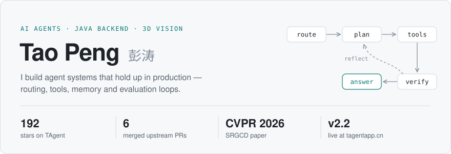
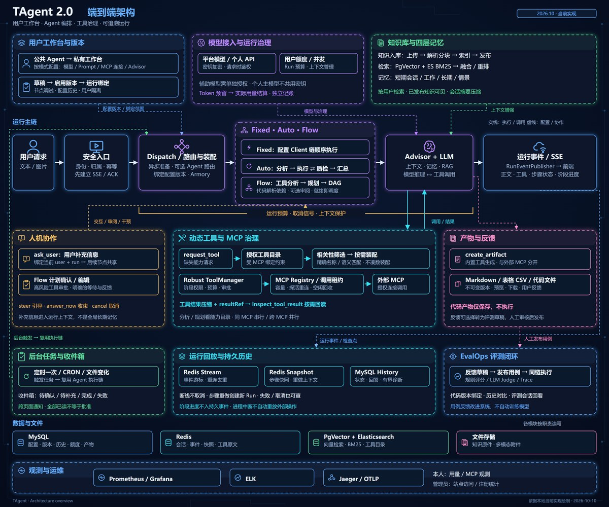

  <picture>
    <source media="(prefers-color-scheme: dark)" srcset="assets/hero-dark.svg">
    
  </picture>

  <a href="https://tagentapp.cn">tagentapp.cn</a> &nbsp;·&nbsp;
  <a href="https://github.com/pengmoubuaixuexi/TAgent">TAgent</a> &nbsp;·&nbsp;
  <a href="https://github.com/pengmoubuaixuexi/SRGCD">SRGCD</a> &nbsp;·&nbsp;
  <a href="mailto:3269417457@qq.com">3269417457@qq.com</a>

## Building

### [TAgent](https://github.com/pengmoubuaixuexi/TAgent) — a multi-user AI agent platform

Java 17 · Spring Boot · Spring AI. Running in production at [tagentapp.cn](https://tagentapp.cn).

- Agents, models, tools and advisors are database rows, assembled at runtime
- Fixed / Auto / Flow modes: a reflection loop, or a DAG plan with parallel steps
- MCP tools matched on demand, with human approval for risky calls
- Model failover, attachments, a Python sandbox and replayable run traces
- Failed runs → reviewed → candidate agent → A/B evaluation → enabled

[Live demo](https://tagentapp.cn) · [Source](https://github.com/pengmoubuaixuexi/TAgent) · [Demo videos](https://github.com/pengmoubuaixuexi/TAgent/tree/main/docs/demo-videos)

 

## Upstream contributions

Fixes sent back to the agent frameworks TAgent is built on — all merged.

<!-- merged-prs:start -->
**[spring-projects/spring-ai](https://github.com/spring-projects/spring-ai)**

- [#6953](https://github.com/spring-projects/spring-ai/pull/6953) Copy message lists when saving in-memory chat history

**[agentscope-ai/agentscope-java](https://github.com/agentscope-ai/agentscope-java)**

- [#3784](https://github.com/agentscope-ai/agentscope-java/pull/3784) fix(a2a): preserve completed status update messages
- [#3538](https://github.com/agentscope-ai/agentscope-java/pull/3538) fix(harness): count pruning budgets per tool result
- [#3220](https://github.com/agentscope-ai/agentscope-java/pull/3220) fix(jdbc): return unconditional write versions atomically
- [#3149](https://github.com/agentscope-ai/agentscope-java/pull/3149) fix(core): handle synchronous failures in model fallback
- [#3128](https://github.com/agentscope-ai/agentscope-java/pull/3128) fix(core): retain reasoning details from all streaming chunks
<!-- merged-prs:end -->

## Research

### [SRGCD](https://github.com/pengmoubuaixuexi/SRGCD) CVPR 2026

**Stability-Driven Region Growth Framework for 3D Change Detection.** Reliable unchanged seeds guide progressive region growth for 3D point-cloud change detection.

[Paper](https://openaccess.thecvf.com/content/CVPR2026/html/Wu_SRGCD_Stability-Driven_Region_Growth_Framework_for_3D_Change_Detection_CVPR_2026_paper.html) · [Project page](https://github.com/pengmoubuaixuexi/SRGCD)

Code will be released with the journal extension.

 
